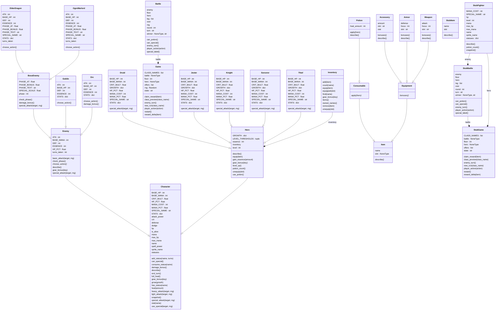

# Essence of the Five: study guide (ELI5)

Read your own section (10 minutes), run its demos once (5 minutes), then read everyone else's one-line analogies (10 minutes). Every code reference below was generated from the real files by a script and re-checked, and every demo output was captured by actually running it.

**Order to learn it:** the story first (next section), then your own section, then the quick cut.

## The whole game in 60 seconds

You pick one of five heroes. You fight four monsters in a row: Goblin, Orc, Ogre Warlord, Elder Dragon. Each turn you click Light, Heavy, Special or Potion (or click the monster to Light-attack it). Win a fight and you choose 1 of 3 rewards. Beat the Dragon to win. Lose once and the run ends.

Three layers, and the layers only talk downward:

1. **`models/`** (what things are): characters, items. Knows nothing about screens.
2. **`logic/`** (the rules): `Battle` runs one fight, `Game` runs the whole run. Also knows nothing about screens.
3. **`ui/`** (what you see and click): a Tkinter menu, then Pygame battle/reward/end screens. `main.py` hands the one shared `Game` from window to window.

That separation is itself a test: `tests/test_no_gui_in_models.py` fails if `models/` or `logic/` ever mention a GUI toolkit.

## Who wrote what (and how sure we are)

The git history has almost one committer, because teammates sent files to the Lead (see the README "How to contribute"). So **who owns what comes from the README ownership table, the handoff files and the commit messages**, and git blame only partly agrees. The raw git evidence:

```
87	T3 Code
    14	flymywings
     1	loudwig1124
     1	shn
```

| Person | File | Lines (git blame, by author name) |
|---|---|---|
| Daniel | `models/heroes.py` | flymywings 146, loudwig1124 47 |
| Daniel | `models/enemies.py` | flymywings 145, loudwig1124 19 |
| TJ | `models/items.py` | flymywings 251 |
| Khael | `ui/theme.py` | flymywings 138 |
| Khael | `ui/battle.py` | flymywings 225 |
| Joseph | `ui/menu.py` | flymywings 132 |
| Joseph | `ui/reward.py` | flymywings 97 |
| Joseph | `ui/end.py` | flymywings 74 |
| Lead | `models/character.py` | flymywings 280 |
| Lead | `logic/battle.py` | flymywings 122 |
| Lead | `logic/game.py` | flymywings 142 |
| Lead | `logic/stub.py` | flymywings 192 |
| Lead | `main.py` | flymywings 144 |
| Lead | `tests/test_character.py` | flymywings 118 |
| Lead | `tests/test_game.py` | flymywings 104 |
| Lead | `tests/test_models.py` | flymywings 108 |
| Lead | `tests/test_no_gui_in_models.py` | flymywings 15 |
| Lead | `tests/test_properties.py` | flymywings 148 |
| Lead | `tests/test_sound.py` | flymywings 260 |
| Lead | `ui/sound.py` | flymywings 136 |
| Lead | `tools/process_sounds.py` | flymywings 117 |

Commit messages that name people: `a8752d2` "Items and inventory (TJ)", `5b57a03` "Menu, reward and end screens (Joseph)", `0e009c1` "Heroes and enemies" (by `loudwig1124`, merged in PR #1). **Guess to confirm:** `loudwig1124` is Daniel. Khael's `ui/theme.py` and `ui/battle.py` were copied in from his zip and show up as the Lead's lines in blame. The sound files and the property tests were added last by the Lead.

## Time plan

| Person | Learn your part | Present | What you cover |
|---|---|---|---|
| Daniel | 8 min | 2-3 min | classes and objects, inheritance, polymorphism |
| TJ | 8 min | 2-3 min | abstraction, aggregation, items |
| Lead | 14 min | 4-5 min | encapsulation, composition, association, the rules, tests, sound |
| Khael | 8 min | 2-3 min | the Pygame mouse GUI, sprites |
| Joseph | 8 min | 2-3 min | the Tkinter mouse GUI, reward and end screens |
| **Total** | **46 min** | **13-17 min** | plus 5 min for questions |

### If you only have 5 minutes
Say one sentence per concept (the **ELI5** lines below) and run only these three demos:
1. **Polymorphism** (Daniel): the same call, five different results.
2. **Encapsulation** (Lead): try to give a hero 1,000,000 HP.
3. **Mouse GUI, Pygame** (Khael): run `python main.py`, pick a hero, click the monster.

---
# Daniel: heroes and enemies (`models/heroes.py`, `models/enemies.py`)

**Your job in one sentence:** you wrote the five hero classes and the four monster classes, and each one does its own special thing.

### 1. Classes and objects

**ELI5:** A class is a cookie cutter; an object is one cookie. `Knight` is the cutter, `Knight()` makes a cookie, and biting one cookie does not change the others.

**Where in the code:**

`models/heroes.py:75`
```python
class Knight(Hero):
    """Tank. Shield Bash: 1.2x attack, then BLOCK halves the next hit taken."""

    BASE_HP, HP_PCT, BASE_MANA, MANA_PCT = 100, 1.20, 20, 1.00
```

`models/heroes.py:86`
```python
super().__init__("Knight")
```

`models/heroes.py:192`
```python
HERO_CLASSES = {"Knight": Knight, "Thief": Thief, "Jester": Jester,
                "Sorcerer": Sorcerer, "Druid": Druid}
```

**Show it live** (open a terminal in the project folder, run `python`, paste this):
```python
from models.heroes import Knight
a, b = Knight(), Knight()
a.hp = 10
print(a.describe())
print("a.hp =", a.hp, "| b.hp =", b.hp, "| same object?", a is b)
```
**You will see:**
```
Knight Lv1 - Shield Bash (10 MP)
a.hp = 10 | b.hp = 158 | same object? False
```

**The professor asks:** *What is the difference between a class and an object?*

**You say:** A class is the blueprint (`Knight`), an object is one instance made from it (`Knight()`). Two Knights share the blueprint but each has its own HP, as the demo shows.
### 2. Inheritance

**ELI5:** A family tree: a Knight is a kind of Hero, a Hero is a kind of Character, and children get everything their parents can do without rewriting it.

**Where in the code:**

`models/heroes.py:14`
```python
class Hero(Character, ABC):
    """Abstract player character: inventory, gear slots, essence and levels."""
```

`models/enemies.py:54`
```python
class BossEnemy(Enemy, ABC):
    """Abstract boss: big hit every 3rd turn and one HP-threshold phase change."""
```

`models/enemies.py:141`
```python
class ElderDragon(BossEnemy):
    """Floor 4 boss. Breath every 3rd turn; PHASE 2 (+25 %) below 50 % HP."""
```

`ABC` in the list is just Python's built-in 'abstract class' helper; ignore it when explaining.

Every child calls `super().__init__(...)` so the parent sets itself up first (`Hero.__init__` creates the inventory, then calls `Character.__init__`).

**Show it live** (open a terminal in the project folder, run `python`, paste this):
```python
from models.heroes import Knight
from models.enemies import ElderDragon
print(" -> ".join(c.__name__ for c in Knight.__mro__))
print(" -> ".join(c.__name__ for c in ElderDragon.__mro__))
```
**You will see:**
```
Knight -> Hero -> Character -> ABC -> object
ElderDragon -> BossEnemy -> Enemy -> Character -> ABC -> object
```

**The professor asks:** *Show me inheritance in your project.*

**You say:** `Character` is the parent of `Hero` and `Enemy`. `Hero` has five children (Knight and so on). `Enemy` has `Goblin` and `Orc`, plus `BossEnemy`, which has `OgreWarlord` and `ElderDragon`. The `__mro__` line is Python listing that family tree.
### 3. Polymorphism

**ELI5:** A remote with one button labelled SPECIAL: press it on five different toys and each toy does its own trick. The remote does not need to know which toy it is.

**Where in the code:**

`models/heroes.py:88`
```python
def special_attack(self, target, rng):
    """_roll_damage(1.2x attack_power), then add_status(BLOCK). Returns a log line."""
    line = self._roll_damage(target, self.attack_power * 1.2, rng, "Shield Bash")
    self.add_status(BLOCK)
```

`models/heroes.py:162`
```python
def special_attack(self, target, rng):
    """_roll_damage(1.0x spell_power, ignore_armor=True). Returns a log line."""
    return self._roll_damage(target, self.spell_power * 1.0, rng,
```

`models/enemies.py:112`
```python
def damage_bonus(self):
    """1.25 while hp < 50 % of max_hp, else 1.0."""
    if self.hp < self.max_hp * 0.5:
        return 1.25
```

`logic/battle.py:108`
```python
if enemy.choose_action() == "special":
    self.log.append(enemy.special_attack(hero, self.rng))
else:
    self.log.append(enemy.basic_attack(hero, self.rng))
```

**Show it live** (open a terminal in the project folder, run `python`, paste this):
```python
import random
from models.heroes import HERO_CLASSES
from models.enemies import make_enemy
rng = random.Random(3)
for name, cls in HERO_CLASSES.items():
    hero = cls(); hero.hp = hero.max_hp // 2          # a hurt hero, so the Druid's heal shows
    print(name.ljust(9), hero.special_attack(make_enemy(1), rng))
for floor in (1, 2, 3, 4):
    e = make_enemy(floor)
    print(e.name.ljust(13), [e.choose_action() for _ in range(6)])
```
**You will see:**
```
Knight    Knight's Shield Bash hits Goblin for 7. Knight braces for the next hit (BLOCK).
Thief     Thief's Backstab hits Goblin for 10 [CRIT].
Jester    Jester's Trick hits Goblin for 9 [ignores armor]. Jester feels lucky (CRIT UP).
Sorcerer  Sorcerer's Fireball hits Goblin for 32 [ignores armor].
Druid     Druid heals 28 HP and sets REGEN. Druid's Rejuvenate hits Goblin for 14 [ignores armor].
Goblin        ['attack', 'attack', 'attack', 'attack', 'attack', 'attack']
Orc           ['attack', 'attack', 'attack', 'attack', 'attack', 'attack']
Ogre Warlord  ['attack', 'attack', 'special', 'attack', 'attack', 'special']
Elder Dragon  ['attack', 'attack', 'special', 'attack', 'attack', 'special']
```

**The professor asks:** *Where is polymorphism?*

**You say:** `special_attack` and `choose_action` are declared once in the parent and every subclass overrides them. `Battle` just calls `hero.use_special(...)` and `enemy.choose_action()` without checking the type, and each class does its own thing. In the demo the five heroes do five different attacks through the same call, and the bosses answer 'special' on every 3rd turn.
---
# TJ: items and inventory (`models/items.py`)

**Your job in one sentence:** you wrote everything the hero can wear or drink, and the bag that holds it.

### 4. Abstraction

**ELI5:** A blueprint that says 'every vehicle must be able to move' but is not a vehicle itself. You cannot drive the blueprint, only real vehicles built from it.

**Where in the code:**

`models/items.py:6`
```python
class Item(ABC):
    """Abstract item: a name and a description."""
```

`models/items.py:15`
```python
@abstractmethod
def describe(self):
    """One line for the reward card, e.g. 'Warhammer: +15 attack'."""
```

`models/items.py:20`
```python
class Equipment(Item, ABC):
    """Abstract gear that sits in one slot and gives bonuses."""

    @abstractmethod
    def bonuses(self):
```

`models/character.py:28`
```python
class Character(ABC):
```

**Show it live** (open a terminal in the project folder, run `python`, paste this):
```python
from models.items import Item
from models.character import Character
from models.enemies import Enemy
for cls in (Item, Character, Enemy):
    try:
        cls("x")
    except TypeError as e:
        print(cls.__name__, "->", e)
```
**You will see:**
```
Item -> Can't instantiate abstract class Item without an implementation for abstract method 'describe'
Character -> Can't instantiate abstract class Character without an implementation for abstract methods 'describe', 'special_attack'
Enemy -> Can't instantiate abstract class Enemy without an implementation for abstract method 'choose_action'
```

**The professor asks:** *What is abstraction and why is `Item` abstract?*

**You say:** An abstract class is a template that cannot be created itself; it forces every child to fill in the missing methods (here `describe()`, and `bonuses()` or `apply()`). It makes sure every item can describe itself for the reward card, whatever kind it is. The demo shows Python refusing to build one.
### 5. Aggregation

**ELI5:** A backpack and the things in it: the sword was made somewhere else, you just put it in the bag, and the same sword could go into someone else's bag.

**Where in the code:**

`models/items.py:128`
```python
def add(self, item):
    """Put an item in the bag (aggregation: the item was made elsewhere)."""
    self.__items.append(item)
```

`models/items.py:227`
```python
def make_item(name):
    """A NEW Item object for this catalogue name."""
    kind, first, second = CATALOGUE[name]
```

**Show it live** (open a terminal in the project folder, run `python`, paste this):
```python
from models.items import Inventory, make_item
sword = make_item("Iron Sword")      # made OUTSIDE the inventory
bag1, bag2 = Inventory(), Inventory()
bag1.add(sword)
bag2.add(sword)
print("same sword in both bags:", bag1.items()[0] is bag2.items()[0])
```
**You will see:**
```
same sword in both bags: True
```

**The professor asks:** *Which of your relationships is aggregation, and why?*

**You say:** `Inventory` holds `Item` objects that were created outside it by `make_item`, so the items have their own life and can be shared; the bag only holds references. (Honest note: the lab's own aggregation example is a Team of Heroes, which this game does not have, so this is the closest thing.)
### 6. Items: one parent, many children, one call

**ELI5:** A toolbox where every tool, whatever it is, answers the same question: 'what do you add to me?'

**Where in the code:**

`models/items.py:39`
```python
def bonuses(self):
    """{'attack': attack, 'focus': focus}."""
```

`models/items.py:85`
```python
def bonuses(self):
    """{stat: amount}."""
```

`models/items.py:177`
```python
def gear_bonus(self, key):
    """Sum of bonuses()[key] over the equipped items."""
    return sum(item.bonuses().get(key, 0)
```

**Show it live** (open a terminal in the project folder, run `python`, paste this):
```python
from models.heroes import Knight
from models.items import make_item
k = Knight()
print("attack before:", k.attack_power)
for name in ("Iron Sword", "Bracer of Might"):
    item = make_item(name); k.inventory.add(item); k.equip(item)
print("attack after :", k.attack_power)
```
**You will see:**
```
attack before: 8
attack after : 17
```

**The professor asks:** *How does a sword change a hero's damage?*

**You say:** The `Inventory` asks every equipped item for its `bonuses()` and adds them up (`gear_bonus`). `Weapon`, `Armor` and `Accessory` each answer in their own way, and the hero's `attack_power` reads the total. That is polymorphism again: the inventory never checks which kind of item it has.
---
# Lead: the core rules, the run, the router, the tests and the sound (`models/character.py`, `logic/`, `main.py`, `tests/`, `ui/sound.py`)

**Your job in one sentence:** you wrote the parent of every fighter, the rules of one fight, the run that chains four fights, the tests that guard it all, and the sound effects.

### 7. Encapsulation

**ELI5:** A vending machine: you press buttons, but you cannot reach into the cash box. HP is the cash box; the `hp` setter is the machine that refuses nonsense.

**Where in the code:**

`models/character.py:46`
```python
self.__statuses = {}
self.__hp = self.max_hp
self.__mana = self.max_mana
```

`models/character.py:117`
```python
def hp(self, value):
    if not isinstance(value, int):
        raise TypeError("hp must be an int")
    self.__hp = max(0, min(value, self.max_hp))
```

`models/items.py:125`
```python
self.__items = []
self.__slots = {slot: None for slot in SLOTS}
```

`models/items.py:138`
```python
return tuple(self.__items)
```

**Show it live** (open a terminal in the project folder, run `python`, paste this):
```python
from models.heroes import Knight
k = Knight()
k.hp = 10**6
print(f"asked for 1,000,000 HP, got {k.hp} (max {k.max_hp})")
try: k.hp = "a lot"
except TypeError as e: print("TypeError:", e)
try: print(k.__hp)
except AttributeError as e: print("AttributeError:", e)
print("bag copy is a", type(k.inventory.items()).__name__, "so nobody can edit the real list")
```
**You will see:**
```
asked for 1,000,000 HP, got 158 (max 158)
TypeError: hp must be an int
AttributeError: 'Knight' object has no attribute '__hp'
bag copy is a tuple so nobody can edit the real list
```

**The professor asks:** *What is encapsulation and where do you use it?*

**You say:** Hiding the data and controlling access to it. `__hp`, `__mana` and `__statuses` are private; the only way in is the `hp` and `mana` properties, which check the type and clamp the value to 0..max. `Inventory` also hides its list and hands out a tuple copy. So no part of the game can put a hero at 1,000,000 HP or negative HP.
### 8. Composition

**ELI5:** A house and its rooms: build the house and the rooms come with it; knock it down and the rooms are gone too. A Hero is born with its own Inventory.

**Where in the code:**

`models/heroes.py:22`
```python
self.inventory = Inventory()       # composition: the Hero owns its Inventory
```

`logic/battle.py:19`
```python
self.enemy = make_enemy(floor)
```

`logic/game.py:60`
```python
"""self.battle = Battle(self.hero, self.floor, self.rng)."""
```

**Show it live** (open a terminal in the project folder, run `python`, paste this):
```python
from logic.game import Game
g = Game(seed=1)
g.new_run("Knight")
first_bag, first_enemy = g.hero.inventory, g.battle.enemy
g.restart(); g.new_run("Knight")
print("new run, same inventory object?", g.hero.inventory is first_bag)
print("new run, same enemy object?    ", g.battle.enemy is first_enemy)
```
**You will see:**
```
new run, same inventory object? False
new run, same enemy object?     False
```

**The professor asks:** *What is composition and which classes show it?*

**You say:** A strong 'owns' relationship where the part lives and dies with the owner. `Hero` creates its own `Inventory`, `Battle` creates its own `Enemy`, and `Game` creates its own `Battle`. When a run restarts everything is rebuilt from scratch, as the demo shows (new objects every time).
### 9. Association

**ELI5:** A referee and the players: the referee works with the players during the match but does not own them, and the players are still there after the match.

**Where in the code:**

`logic/battle.py:18`
```python
self.hero = hero
```

`logic/game.py:60`
```python
"""self.battle = Battle(self.hero, self.floor, self.rng)."""
```

**Show it live** (open a terminal in the project folder, run `python`, paste this):
```python
import random
from logic.battle import Battle
from models.heroes import Knight
hero = Knight()
b1 = Battle(hero, 1, random.Random(1))
b2 = Battle(hero, 2, random.Random(1))
print("both fights use the same hero:", b1.hero is b2.hero)
print("but each made its own enemy:", b1.enemy.name, "and", b2.enemy.name, "| same enemy?", b1.enemy is b2.enemy)
```
**You will see:**
```
both fights use the same hero: True
but each made its own enemy: Goblin and Orc | same enemy? False
```

**The professor asks:** *How is association different from composition in your code?*

**You say:** `Battle` only borrows the hero (a plain reference passed in, which lives on after the fight), but it creates and owns its enemy. Same class, two relationships: hero = association, enemy = composition. Hero versus Inventory is composition too.
### 10. The rules, in one place

**ELI5:** One referee desk: every hit in the whole game goes through the same six steps, so there is one place to fix a bug.

**Where in the code:**

`models/character.py:221`
```python
def _roll_damage(self, target, power, rng, label,
                 dodgeable=True, ignore_armor=False, force_crit=False):
    """raw -> crit -> dodge -> armor -> BLOCK -> apply. Returns a log line.
```

`models/character.py:251`
```python
damage = max(1, damage)
```

`logic/game.py:77`
```python
def _update_state(self):
    """Hero won: VICTORY on floor 4, else make 3 offers and go to REWARD.
    Enemy won: DEFEAT."""
    if self.battle.winner == "hero":
        if self.floor >= LAST_FLOOR:
            self.state = VICTORY
```

**Show it live** (open a terminal in the project folder, run `python`, paste this):
```python
import random
from models.heroes import Thief
from models.enemies import make_enemy
print(Thief().special_attack(make_enemy(1), random.Random(3)))
from logic.game import Game
g = Game(seed=2); g.new_run("Druid"); g.battle.enemy.hp = 1
print("state:", g.state)
while g.state == "battle":
    g.player_action("light")
    if g.state == "battle": g.enemy_turn()
print("state after the win:", g.state, "| offers:", [i.name for i in g.offers])
```
**You will see:**
```
Thief's Backstab hits Goblin for 10 [CRIT].
state: battle
state after the win: reward | offers: ['Oak Staff', 'Dragon Fang', 'Bracer of Might']
```

**The professor asks:** *Where is the game logic and how does it move between screens?*

**You say:** Damage is computed in one method, `_roll_damage` (raw, crit, dodge, armor, block, apply), and nothing else subtracts HP. `Game` is a small state machine (`menu`, `battle`, `reward`, `victory`, `defeat`); the screens only read `game.state` and call `app.show()`.
### 11. Tests

**ELI5:** A robot inspector that tries to break the machine, over and over, and shouts if any rule is broken.

**Where in the code:**

`tests/test_character.py:40`
```python
def test_damage_never_below_one():
    rng = random.Random(1)
    weak = Dummy(attack=1)
    wall = Dummy(defense=999)
    for _ in range(300):
```

`tests/test_no_gui_in_models.py:10`
```python
offenders = [f"{path.relative_to(ROOT)} mentions {word}"
             for folder in ("models", "logic")
             for path in (ROOT / folder).rglob("*.py")
             for word in TOOLKITS
             if word in path.read_text(encoding="utf-8")]
```

`tests/test_properties.py:73`
```python
def test_hp_and_mana_setters_clamp(stats, hp, mana):
    c = Dummy(stats)
    c.hp, c.mana = hp, mana
    assert 0 <= c.hp <= c.max_hp
    assert 0 <= c.mana <= c.max_mana
```

**Show it live:** `pip install -r requirements-dev.txt` then `python -m pytest -q`.
**You will see:**
```
77 passed in 4.56s
```

**The professor asks:** *How do you know it works?*

**You say:** 77 tests run with `python -m pytest` (the demo shows the live count). The unit tests check specific rules (damage is never below 1, abstract classes cannot be built). The property tests use `hypothesis` to throw thousands of random stats, seeds and click sequences at the game and check that HP and mana always stay in range and that the floor never goes backwards. One test even scans `models/` and `logic/` to make sure no GUI toolkit is imported.
### 12. Sound

**ELI5:** A sound-effects person watching the commentary script: when the script says 'critical hit', they press the crit sound.

**Where in the code:**

`ui/sound.py:87`
```python
def events_for_log_line(line, hero_name, enemy_name):
    """Map one Battle.log line to the sound events it should play (usually 0 or 1).

    The log is plain text, so the match is on the exact phrases written in
    models/character.py, models/heroes.py and models/items.py.
    """
```

`ui/battle.py:98`
```python
for line in battle.log[self.seen:]:
    for event in sound.events_for_log_line(line, battle.hero.name, battle.enemy.name):
        sound.play(event)
self.seen = len(battle.log)
```

`ui/sound.py:47`
```python
except Exception:          # no audio device, bad driver, corrupt file: stay silent
    _state["failed"] = True
    _sounds.clear()
```

*Heads-up for questions:* sound is listed as out of scope in the planning docx and the handoffs say 'no sound'. Be ready to say it was a late optional extra. The Undertale sound effects are Toby Fox's and are used for a class project only (see `sounds/SOURCES.md`).

**Show it live** (open a terminal in the project folder, run `python`, paste this):
```python
from ui import sound
for line in ["Knight's Light Attack hits Goblin for 14.",
             "Goblin's attack is DODGED by Knight!",
             "Knight's Heavy Attack hits Goblin for 22 [CRIT]."]:
    print(sound.events_for_log_line(line, "Knight", "Goblin"), "<-", line)
```
**You will see:**
```
['light'] <- Knight's Light Attack hits Goblin for 14.
['dodge'] <- Goblin's attack is DODGED by Knight!
['crit'] <- Knight's Heavy Attack hits Goblin for 22 [CRIT].
```

**The professor asks:** *Doesn't sound break your rule that models and logic have no GUI code?*

**You say:** No: all audio is in `ui/`. The battle screen reads the new lines of the battle log and maps each to a sound; `models/` and `logic/` are untouched. If there is no sound card or the files are missing, `ensure()` catches the error and the game runs silently.
---
# Khael: the look, the battle screen and the sprites (`ui/theme.py`, `ui/battle.py`, `assets/`)

**Your job in one sentence:** you made the battle screen, its buttons and colours, and the sprites.

### 13. Mouse GUI (Pygame): hover, click, click the monster

**ELI5:** A TV remote: the button lights up when you point at it (hover), and pressing it sends a command. Here, clicking the monster's picture is the same command as pressing the Light button.

**Where in the code:**

`ui/theme.py:120`
```python
elif self.rect.collidepoint(pygame.mouse.get_pos()):
    colour, text_colour = HOVER, FG
else:
```

`ui/theme.py:114`
```python
return self.enabled and self.rect.collidepoint(pos)
```

`ui/battle.py:78`
```python
if self.portrait.collidepoint(pos):
    sound.play("click")
    self.on_action("light")
    return
```

`main.py:114`
```python
elif (event.type == pygame.MOUSEBUTTONDOWN and event.button == 1
      and self.running and self.screen is current):
    self.screen.handle_click(event.pos)
```

**For real:** run `python main.py`, pick a hero, press Start, then click the monster instead of the Light button.

**Show it live** (open a terminal in the project folder, run `python`, paste this):
```python
import os; os.environ["SDL_VIDEODRIVER"] = "dummy"
import pygame; pygame.init(); pygame.display.set_mode((1100, 720))
from logic.game import Game
from ui.battle import BattleScreen
class App:                      # tiny stand-in for main.py's window
    def __init__(self, game): self.game = game
    def show(self): pass
g = Game(seed=1); g.new_run("Knight")
screen = BattleScreen(App(g))
screen.handle_click(screen.portrait.center)      # a click on the monster picture
print(g.battle.log[-1])
```
**You will see:**
```
Knight's Light Attack hits Goblin for 14.
```

**The professor asks:** *How does the mouse control the game?*

**You say:** Pygame sends a `MOUSEBUTTONDOWN` event with the position; `main.py` passes it to the current screen's `handle_click(pos)`, which checks which button or the monster portrait contains that point and calls the same `game.player_action(...)`. Hover is drawn by checking if the mouse is over the button each frame. There is no keyboard code anywhere.
### 14. Sprites

**ELI5:** Paper dolls: each character has one 200x200 picture, looked up by the character's class name.

**Where in the code:**

`models/character.py:268`
```python
return type(self).__name__.lower()
```

`ui/theme.py:130`
```python
def load_surface(name):
    """Pygame Surface of assets/<name>.png, or None if the file is missing."""
    path = os.path.join(ASSETS, name + ".png")
    if not os.path.exists(path):
        return None
    image = pygame.image.load(path)
```

`ui/battle.py:66`
```python
return pygame.transform.scale(image, SPRITE_SIZE)
```

**Show it live** (open a terminal in the project folder, run `python`, paste this):
```python
from models.enemies import make_enemy
from models.heroes import Druid
print(Druid().sprite_name, "->", "assets/druid.png")
print(make_enemy(3).sprite_name, "->", "assets/ogrewarlord.png")
```
**You will see:**
```
druid -> assets/druid.png
ogrewarlord -> assets/ogrewarlord.png
```

**The professor asks:** *Where do the pictures come from and how are they loaded?*

**You say:** Each character's `sprite_name` is its lowercase class name, so `OgreWarlord` loads `assets/ogrewarlord.png`. If a file is missing the screen draws a coloured box instead of crashing. Hero art is Khael's; goblin, orc and ogre are CraftPix (OGA-BY 3.0) and the dragon is Chibizilla (CC-BY 4.0).
---
# Joseph: the menu, reward and end screens (`ui/menu.py`, `ui/reward.py`, `ui/end.py`)

**Your job in one sentence:** you made the first screen you see (hero select), the reward cards after each win, and the Victory/Defeat screen with Restart.

### 15. Mouse GUI (Tkinter): the hero menu

**ELI5:** A vending-machine panel: you press a picture button to choose, and the Start button only lights up once you have chosen something.

**Where in the code:**

`ui/menu.py:46`
```python
button = theme.HoverButton(row, text=name, command=lambda n=name: self.pick(n),
                           font=theme.FONT_HEAD, padx=10, pady=8,
                           highlightthickness=3, highlightbackground=theme.BG,
```

`ui/menu.py:37`
```python
image = theme.load_sprite(name.lower())
```

`ui/menu.py:112`
```python
self.start_button.configure(state="normal")
```

`ui/theme.py:87`
```python
return tk.PhotoImage(file=path)
```

`ui/menu.py:131`
```python
self.app.game.new_run(self.selected)
self.app.show()
```

**For real:** run `python main.py` and move the mouse over the five hero buttons.

**Show it live** (open a terminal in the project folder, run `python`, paste this):
```python
import tkinter as tk
from logic.game import Game
from ui.menu import MenuScreen
class App:                      # tiny stand-in for main.py's window
    def __init__(self): self.game = Game(seed=1)
    def show(self): pass
root = tk.Tk(); root.withdraw()
app = App(); menu = MenuScreen(root, app)
print("Start before picking:", menu.start_button.cget("state"))
menu.buttons["Knight"].invoke()                  # same as a mouse click
print("picked:", menu.selected, "| Start now:", menu.start_button.cget("state"))
menu.start_button.invoke()
print("game state:", app.game.state)
root.destroy()
```
**You will see:**
```
Start before picking: disabled
picked: Knight | Start now: normal
game state: battle
```

**The professor asks:** *Where do you use PhotoImage and hover?*

**You say:** Each class button gets its sprite through `theme.load_sprite`, which wraps `tk.PhotoImage`, and every button is a `HoverButton` that changes colour on Enter and Leave. Clicking only selects; the Start button is disabled until a hero is picked, then `new_run` creates the hero and `app.show()` closes the Tk window so the Pygame battle opens.
### 16. Reward and end screens: one shared state, two windows

**ELI5:** A relay race: the menu runner hands the baton (the one `Game` object) to the battle runner, then reward, then end, and Restart hands it back to the menu.

**Where in the code:**

`ui/reward.py:70`
```python
self.app.game.claim_reward(item)
self.app.show()
```

`ui/end.py:46`
```python
self.app.game.restart()
self.app.show()
```

`main.py:137`
```python
app = TkApp(game) if game.state in TK_SCREENS else PygameApp(game)
app.run()
if app.closed:
```

**Show it live** (open a terminal in the project folder, run `python`, paste this):
```python
from logic.game import Game
g = Game(seed=2); g.new_run("Druid"); g.battle.enemy.hp = 1
while g.state == "battle":
    g.player_action("light")
    if g.state == "battle": g.enemy_turn()
print("after the win     :", g.state, "-> RewardScreen shows", len(g.offers), "cards")
g.claim_reward(g.offers[0])
print("after claiming one:", g.state, "floor", g.floor)
g.state = "defeat"; g.restart()
print("after Restart     :", g.state, "-> back to the Tkinter menu")
```
**You will see:**
```
after the win     : reward -> RewardScreen shows 3 cards
after claiming one: battle floor 2
after Restart     : menu -> back to the Tkinter menu
```

**The professor asks:** *How do the screens switch, and how does Restart work?*

**You say:** There is one `Game` object. Each screen reads `game.state`; after any action, if the state changed it calls `app.show()`. `main.py` loops: Tkinter owns the `menu` state, Pygame owns `battle`, `reward`, `victory` and `defeat`. Restart calls `game.restart()`, which wipes the hero and battle and sets the state to `menu`, so the loop reopens the Tkinter menu.
---
# The class diagram (made by `pyreverse` from the real code)

Command: `pylint`'s `pyreverse -o mmd -p oop models logic` (Mermaid output; no Graphviz on this PC, so no PNG). Paste the block into any Mermaid viewer (GitHub renders it, or https://mermaid.live). It covers `models/` and `logic/`; the UI classes are left out on purpose.



---
# Where the code differs from the planning docx (honest list)

The docx (`Complete.docx`, v1.2) calls itself a working plan. Facts below were checked against the code by a script (output at the end of this section).

| Docx says | The code does |
|---|---|
| Six fights: Goblin, Skeleton Warrior, Cultist, Orc, Ogre Warlord, Elder Dragon | Four floors: Goblin, Orc, Ogre Warlord, Elder Dragon (`FLOORS` in `models/enemies.py`). No Skeleton Warrior, no Cultist |
| Everything in Tkinter, battle window 1280x800 | Tkinter only for the menu; battle, reward and end are Pygame at 1100x720 (`SIZE` in `main.py`) |
| Classes `Shop`, `Dungeon`, `RewardPool`, `Status`; gold; camps | None of these exist. Rewards are made in `Game._make_offers`; statuses are a dictionary inside `Character`; no gold or shop |
| Separate files `inventory.py`, `catalog.py`, `status.py`, `rng.py`, `balance.py`, `simulate.py`, `dungeon.py`, `shop.py`, `ui/app.py`, `ui/screens.py`, `ui/widgets.py` | `Inventory` and the item catalogue are inside `models/items.py`; `ui/theme.py` holds the shared widgets |
| 19 items (7 weapons, 6 armors, 4 accessories, 2 consumables) with prices | 20 items (counts in the script output below), no prices, one potion type |
| Enemy numbers and essence per Tables 5 and 25 | Enemies rebalanced for 4 floors (for example Goblin gives 25 essence, not 12). Level 1 hero numbers still match Table 24 (a test checks it) |
| Sprites generated by `tools/sprites_*.py`, hexagon radar on class cards | Sprites are drawn or downloaded art (heroes by Khael, monsters from OpenGameArt); the menu shows stats as numbers, no radar; no sprite scripts |
| Sound and animation are explicit non-goals; `python main.py --seed` | Sound effects were added late; no animation; `python main.py` or `python main.py stub` only, no `--seed` |

Script output backing these rows:
```
FLOORS ['Goblin', 'Orc', 'OgreWarlord', 'ElderDragon']
CATALOGUE 20 {'weapon': 9, 'armor': 8, 'accessory': 2, 'potion': 1}
class Shop present: False
class Dungeon present: False
class RewardPool present: False
class Status present: False
SkeletonWarrior present: False
Cultist present: False
self.gold present: False
window (1100, 720)
tools/sprites_*.py exist: False
inventory.py exists: False
catalog.py exists: False
status.py exists: False
balance.py exists: False
simulate.py exists: False
```

**Not different:** three layers with models and logic free of GUI code, mouse-only controls, five hero classes with the Table 22/24 numbers, Light/Heavy/Special/Potion, the six-step damage pipeline, the abstract base class tree.

---
# Things I could only guess (confirm these)

1. **Who owns what.** Taken from the README table, handoffs and commit messages, because git has one committer. Confirm with each person, especially that `loudwig1124` is Daniel.
2. **Khael's files.** `ui/theme.py` and `ui/battle.py` came from his zip and the Lead's blame lines hide that. The sound calls inside `ui/battle.py`, and `ui/sound.py`, were added by the Lead (the Lead covers sound).
3. **Week numbers don't agree.** The "Week 3" PDF is Encapsulation and Abstraction, but the Week 5 PDF's final list calls those Week 2 and puts Inheritance and Polymorphism in Week 3. The README follows the second. **No lab PDF for inheritance and polymorphism was available**, so those two definitions are the standard textbook ones, not your professor's wording.
4. **Aggregation.** The lab's aggregation example is a `Team` that holds heroes, and the game has no Team. `Inventory` holding items is the closest fit and is arguable. Be ready to say "the item exists outside the bag and can be shared" and not claim more.
5. **Professor questions.** The "The professor asks" lines are my predictions, not from your professor.
6. **Class diagram.** It has no PNG (no Graphviz here) and leaves out the UI.
7. **The Tk demo uses `invoke()`**, which is a programmatic click, not a real mouse. The real click was checked separately with synthetic mouse events, not by hand on screen.
8. **Who drew the hero sprites.** I only know it from the README ("drawn by Khael"); the git history cannot show it.
9. **Run on `python main.py`** before presenting: I have not seen the real window with the sound on, only headless.
